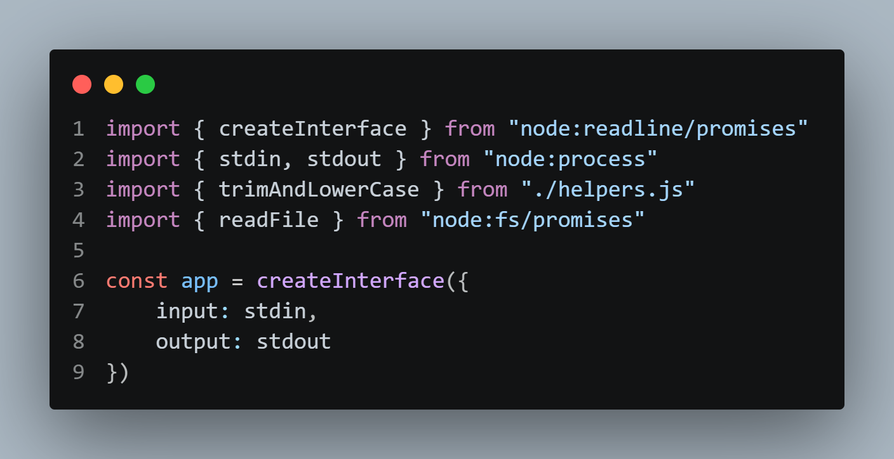
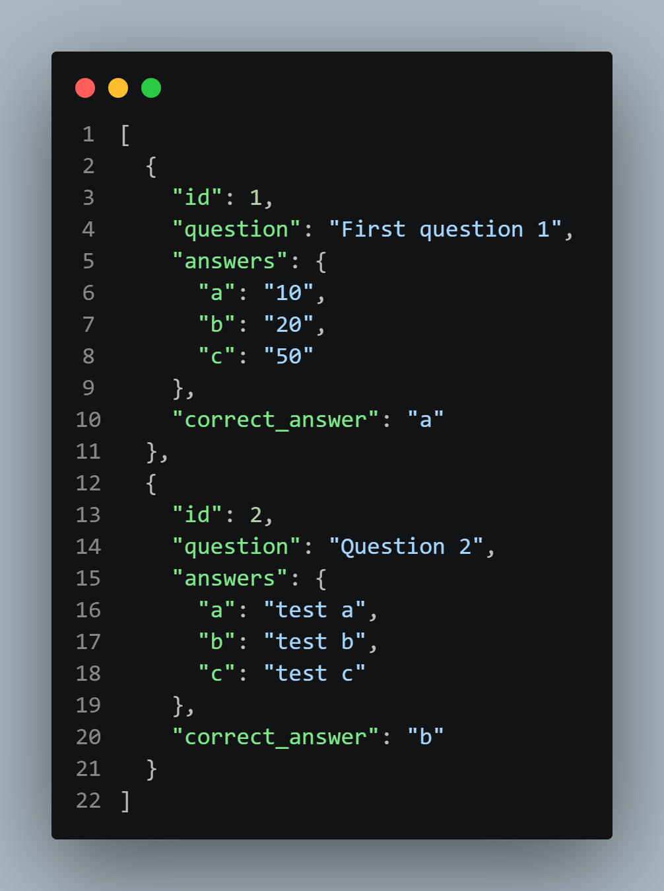
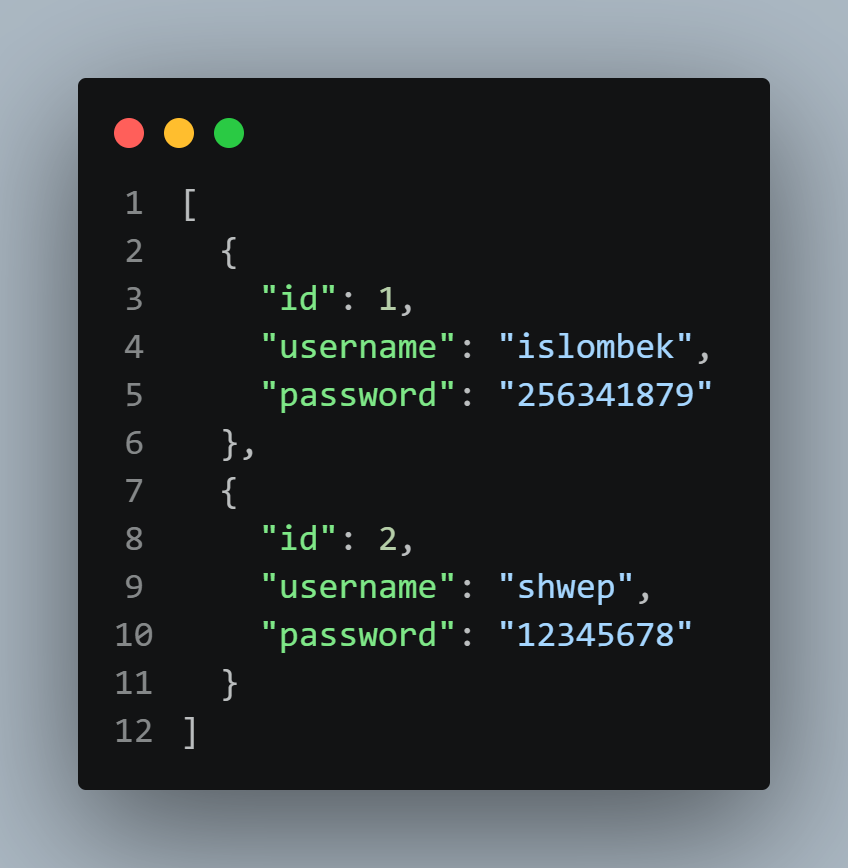
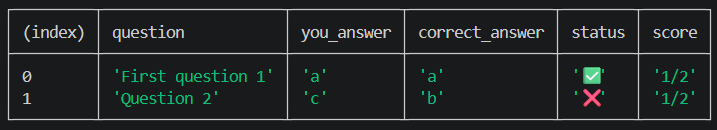

# Node.js Backend Learning and Homework

This repository contains Node.js practice files and a command-line multiple-choice quiz homework project. The homework lives in [`hw/`](hw/); the files at the repository root are separate learning and testing exercises.

## Repository Layout

```text
.
|-- hw/                 # Homework: question creation, user registration, and quiz
|   |-- data/            # User data used by the homework
|   |-- add-question.js  # Add a question to the question bank
|   |-- quiz.js          # Sign in and take the quiz
|   |-- register-user.js # Register a quiz user
|   |-- questions.json   # Saved questions
|   |-- helpers.js       # Shared helper functions
|   `-- hw.txt           # Homework notes/practice file
|-- imgs/                # Screenshots explaining and demonstrating the homework
|-- index.js             # Root-level learning/testing exercises
|-- utils.js             # Root-level ES module practice
|-- utils.cjs            # Root-level CommonJS practice
|-- new-folder/          # Root-level folder/file practice
|   `-- src/new-file.txt
|-- package.json         # Root project configuration
`-- package-lock.json    # Locked root dependency versions
```

The root-level files are practice material, not part of the homework workflow. The homework scripts and its JSON data are collected in `hw/` so the project can be reviewed and used independently.

## Homework: Quiz

The homework is a terminal-based quiz application. It can:

- Register users and save them in `hw/data/users.json`.
- Add multiple-choice questions with three choices and save them in `hw/questions.json`.
- Ask a registered user the saved questions and display the results and score.

### Requirements

- Node.js 18 or newer
- No third-party packages are required to run the homework scripts; they use Node.js built-in modules.

### Run It

Run these commands from the repository root. Each script expects the working directory to be `hw`, because it reads and writes JSON files using paths relative to that folder.

```sh
cd hw
node register-user.js
node add-question.js
node quiz.js
```

Run one command at a time. Register a user before starting the quiz, and add questions before taking it. The root-level `npm run dev` command runs the root learning script (`index.js`), not the homework quiz.

## Screenshots

The images below document the homework's main topic, JSON data structures, and an example quiz result.

### Project topic



### Question data structure



### User data structure



### Example quiz result



## Data Note

The homework stores user passwords as plain text in `hw/data/users.json`. This is a learning example only; do not use real passwords or personal information with it.

## Status

The homework currently includes user registration, question entry, and quiz-taking flows backed by local JSON files. Automated tests and secure password storage are not currently implemented.
